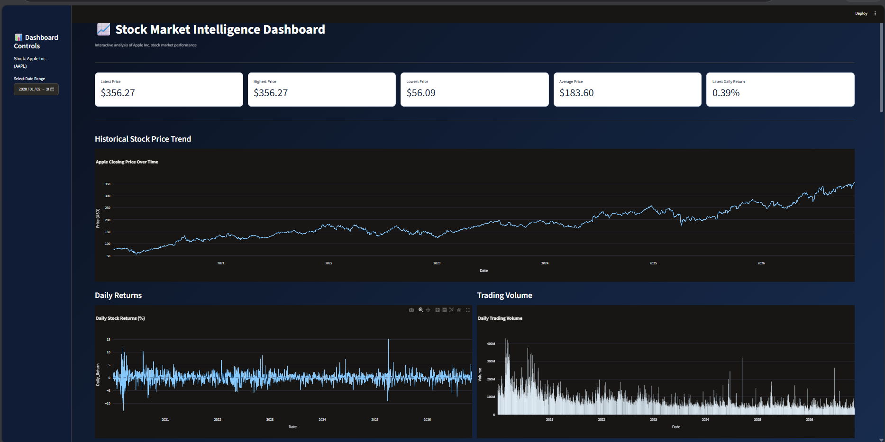
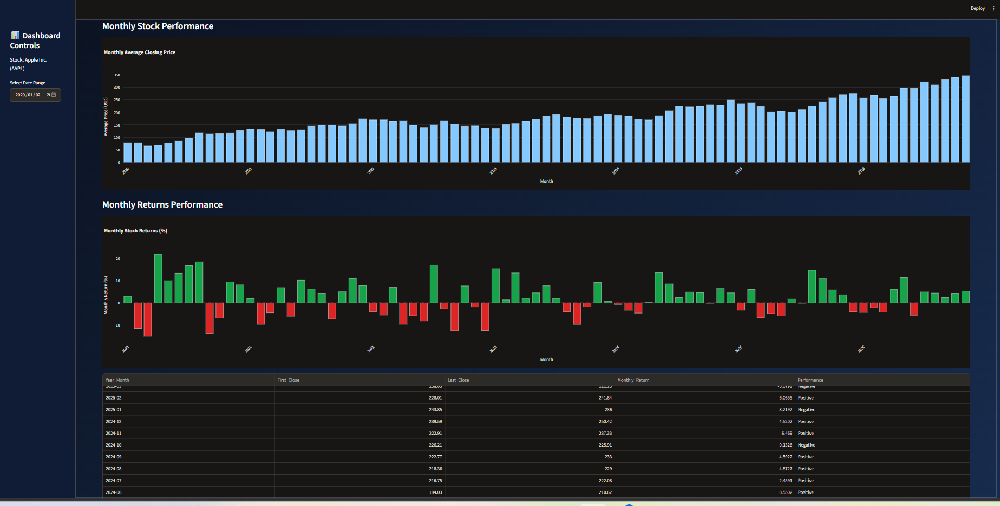
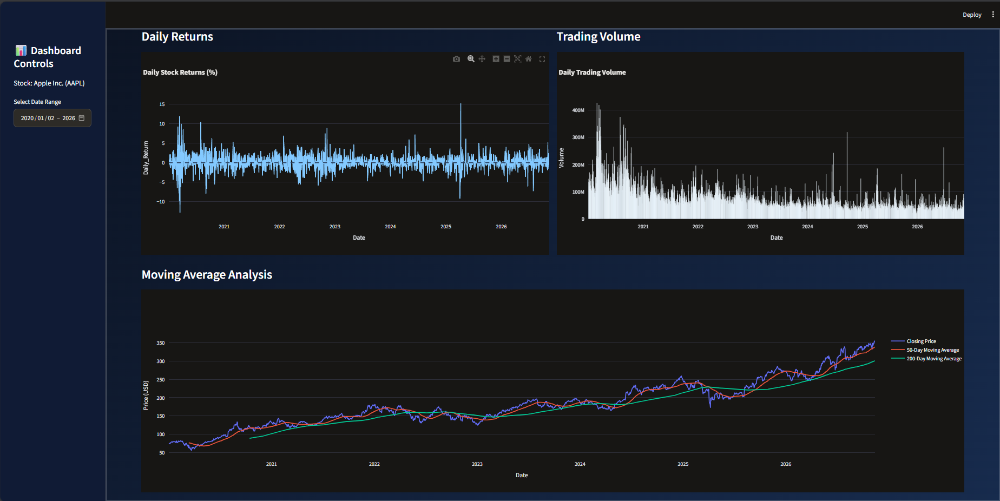
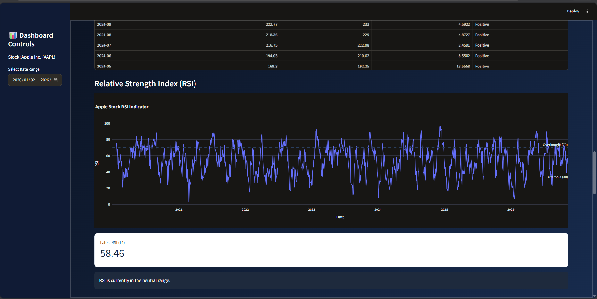
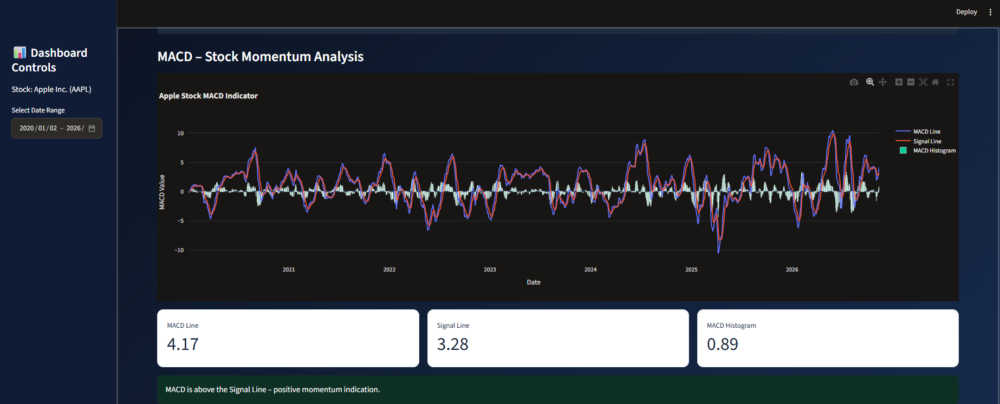
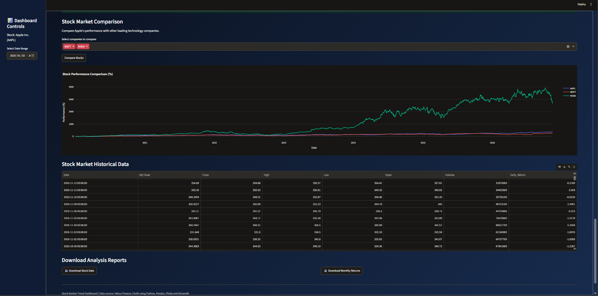

# 📈 Stock Market Trend Dashboard

An interactive stock market analytics dashboard built using **Python, Pandas, Plotly, Streamlit, and Yahoo Finance**.

The project analyses historical stock market data, identifies market trends, calculates technical indicators, compares stock performance, and presents insights through interactive visualizations.

---

## 📌 Project Overview

The Stock Market Trend Dashboard is designed to explore and analyse historical stock market performance.

The project uses Apple Inc. (AAPL) historical stock data and provides interactive analytics to understand stock price movements, daily returns, trading volume, and technical indicators.

Users can also compare Apple with other major technology companies.

## ✨ Key Features

### 1. Stock Price Analysis
- Historical stock closing price analysis.
- Daily percentage returns.
- Highest, lowest, average, and latest closing prices.
- Interactive stock price charts.

### 2. Trading Volume Analysis
- Daily trading volume visualization.
- Historical trading activity analysis.

### 3. Moving Average Analysis
- 50-day moving average.
- 200-day moving average.
- Stock price trend analysis.

### 4. Monthly Performance Analysis
- Monthly average closing price.
- Monthly stock returns.
- Positive and negative monthly performance visualization.

### 5. Technical Indicators

**Relative Strength Index (RSI)**
- Calculates 14-period RSI.
- Identifies potential overbought and oversold conditions.
- Uses 70 and 30 reference levels.

**Moving Average Convergence Divergence (MACD)**
- MACD Line (12-day EMA - 26-day EMA).
- Signal Line (9-day EMA).
- MACD Histogram.
- Stock momentum analysis.

### 6. Stock Comparison
Compare the performance of:
- Apple (AAPL)
- Microsoft (MSFT)
- Google (GOOGL)
- NVIDIA (NVDA)
- Amazon (AMZN)

### 7. Interactive Dashboard
- Interactive date range filtering.
- Dynamic KPI cards.
- Interactive Plotly charts.
- Historical stock data table.

### 8. Download Reports
- Download historical stock data as CSV.
- Download monthly returns analysis as CSV.

---

## 🛠️ Technologies Used

| Technology | Purpose |
|---|---|
| Python | Programming language |
| Pandas | Data cleaning and analysis |
| NumPy | Numerical operations |
| Plotly | Interactive visualizations |
| Streamlit | Dashboard development |
| yfinance | Historical stock data collection |

---

## 📂 Project Structure

```text
02_Stock_Market_Trend_Dashboard/
│
├── data/
│   └── AAPL_stock_data.csv
│
├── notebooks/
│
├── src/
│   ├── fetch_stock_data.py
│   ├── explore_stock_data.py
│   └── visualize_stock_data.py
│
├── outputs/
│   ├── charts/
│   │   ├── closing_price.html
│   │   ├── daily_returns.html
│   │   ├── trading_volume.html
│   │   └── moving_averages.html
│   │
│   ├── stock_analysis_summary.csv
│   └── monthly_stock_analysis.csv
│
├── screenshots/
│   ├── 01_overview.png
│   ├── 02_price_analysis.png
│   ├── 03_moving_averages.png
│   ├── 04_rsi_analysis.png
│   ├── 05_macd_analysis.png
│   └── 06_stock_comparison.png
│
├── app.py
├── requirements.txt
└── README.md
```

---

## 📸 Dashboard Screenshots

### 1. Executive Overview



### 2. Stock Price Analysis



### 3. Moving Average Analysis



### 4. RSI Technical Indicator



### 5. MACD Technical Indicator



### 6. Stock Comparison



---

## 📊 Dataset Information

**Data Source:** Yahoo Finance through the `yfinance` Python library.

**Primary Stock:** Apple Inc. (AAPL)

**Historical Period:** January 2020 onwards, based on the downloaded dataset.

The dataset includes:

- Date
- Open
- High
- Low
- Close
- Adjusted Close
- Volume
- Daily Return

---

## 📈 Sample Analysis Results

The downloaded Apple stock dataset contained the following results at the time of analysis:

| Metric | Result |
|---|---:|
| Total Records | 1,727 |
| Total Columns | 8 |
| Average Closing Price | $183.60 |
| Highest Closing Price | $356.27 |
| Lowest Closing Price | $56.09 |
| Average Daily Return | 0.109% |
| Daily Return Volatility | 1.962% |

*Note: These are results from the downloaded dataset and may change when new stock data is collected.*

---

## ⚙️ Installation and Setup

### Step 1: Clone the repository

```bash
git clone YOUR_GITHUB_REPOSITORY_URL
```

### Step 2: Navigate to the project directory

```bash
cd 02_Stock_Market_Trend_Dashboard
```

### Step 3: Install the required libraries

```bash
python -m pip install -r requirements.txt
```

### Step 4: Download historical stock data

```bash
python src/fetch_stock_data.py
```

### Step 5: Explore the dataset

```bash
python src/explore_stock_data.py
```

### Step 6: Generate stock visualizations

```bash
python src/visualize_stock_data.py
```

### Step 7: Run the Streamlit dashboard

```bash
python -m streamlit run app.py
```

The dashboard will open in your web browser.

---

## 📦 Requirements

The project uses the following Python libraries:

```text
streamlit
pandas
numpy
plotly
yfinance
```

---

## 🎯 Project Objectives

- Understand historical stock market trends.
- Perform exploratory data analysis using Pandas.
- Calculate stock market technical indicators.
- Analyse daily and monthly stock performance.
- Compare the performance of multiple companies.
- Develop an interactive analytics dashboard.
- Present financial data through meaningful visualizations.

---

## 🚀 Future Enhancements

- Add more stock market companies.
- Include additional technical indicators.
- Add candlestick charts.
- Develop stock price prediction models using Machine Learning.
- Add advanced financial performance metrics.
- Deploy the dashboard online.

---

## 👩‍💻 Author

**Vidyalakshmee Beerappa Habagonde**

Aspiring Data Analyst | Python | SQL | Data Analytics | Data Visualization

GitHub: [Vidya0210](https://github.com/Vidya0210)

---

## ⚠️ Disclaimer

This project is developed for educational and analytical purposes only.

Stock market indicators and historical performance do not guarantee future results. This dashboard does not provide financial or investment advice.

---

⭐ If you find this project useful, consider giving the repository a star!